# Drivercom GUI

A desktop GUI for **configuring, logging and analyzing** linear motion system (LMS/XTS) drivers.


## Table of Contents

- [Features](#features)
- [Screen Layout](#screen-layout)
- [Usage](#usage)
  - [1. Controller Configuration](#1-controller-configuration)
  - [2. Data Logging](#2-data-logging)
  - [3. Log Viewer](#3-log-viewer)
  - [4. Vibration Logger](#4-vibration-logger)
  - [5. Tabs, Panels and Files](#5-tabs-panels-and-files)
- [Shortcuts](#shortcuts)
- [Parameter Reference](#parameter-reference)
- [Glossary](#glossary)
- [Documentation](#documentation)
- [Development](#development)

## Features

| Tab | Functions |
|---|---|
| **Configuration** | Read settings from the controller (`Get from port`), gain tuning (`tune`), check calibration values (`calibration`), save settings to the controller, import/save settings files (JSON5), m ↔ mm unit toggle |
| **Logging** | Select log items, duration and axes; save logs as CSV; log while a slider is moving; import/save Log Config files |
| **Log Viewer** | Plot CSV logs; show/hide and search legends; horizontal/vertical zoom; cursor lock; pan; reset; partial save; split/merge/reorder graphs; legend styling |
| **Common** | Multiple tabs and split panels, drag-and-drop file opening, recent files, light/dark theme, version info |

## Screen Layout

| Configuration | Logging | Log Viewer |
|---|---|---|
|  |  |  |

- **Left tree** — selects the `system` / `tune` / `calibration` settings group (toggle with the `Open/Close left dock` button)
- **`Driver status` (right)** — shows the servo, CC-Link and axis status of the connected driver (toggle with the table button)
- **Top bar** — switches between the Configuration / Logging / Log Viewer pages; the buttons at the top right toggle the light/dark theme and show the GUI/CLI version (ⓘ)

## Usage

### 1. Controller Configuration

#### Reading settings

1. Click the `Get from port` button.
2. Select the port of the driver to read settings from.
3. Check that the settings are displayed.

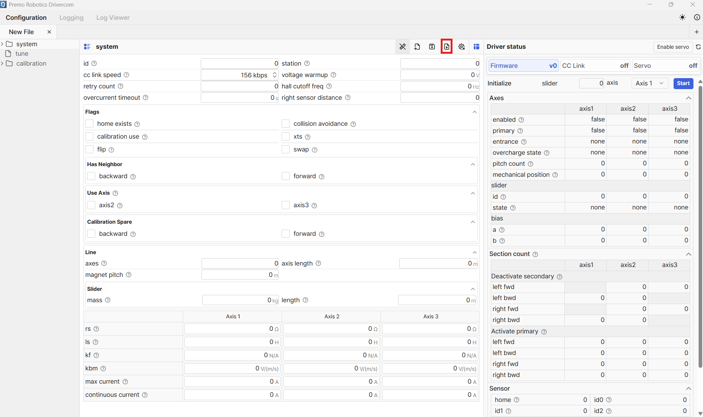

#### Importing and saving settings files

- **Import File** — opens a settings file (`.json5`). Recently opened files are listed for quick access.
- **Save as file** (floppy disk button) — saves the current settings to a `.json5` file. Saving to a file does not change the controller.
- **Change length and weight units** (ruler button) — switches length-based values between m and mm (m/s ↔ mm/s, m/s² ↔ mm/s²) for display and entry.
- **`?` help** — hover over the `?` next to a parameter to see its description. The `flags.flip` and `flags.swap` help shows a sensor diagram.

#### Gain tuning (`tune`)

Adjust the gains of the current, speed and position control loops. The controller response depends on these gains. For example, a higher speed gain makes the slider respond more strongly.

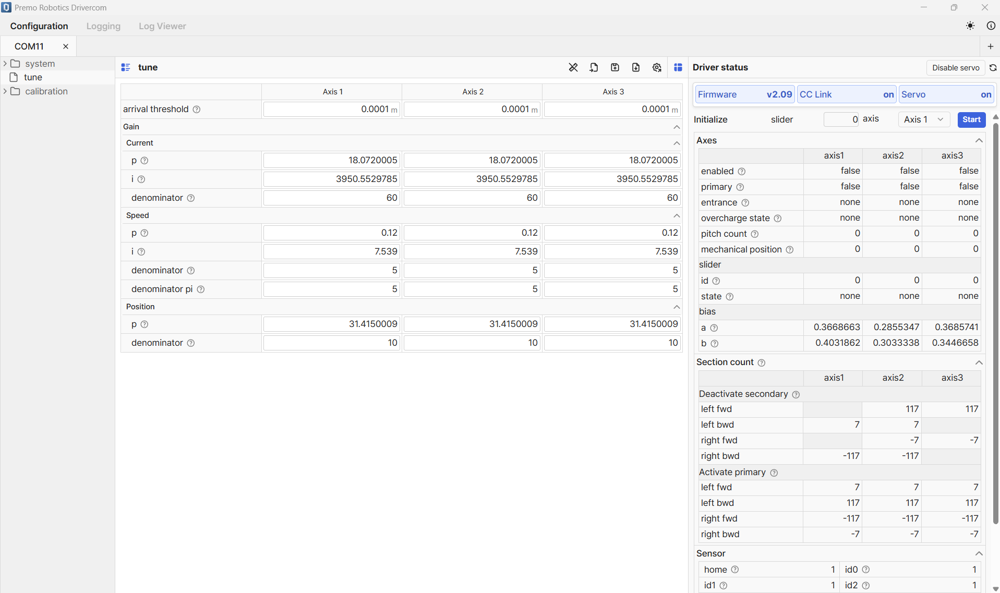

#### Checking calibration values (`calibration`)

Calibration values are measured and entered automatically by the controller. However, **any item shown as 0 after reading settings must be entered manually**.

| Item | Entry rule | Example |
|---|---|---|
| Sensor position (`sensor.position.on/off`) | Correct by the Base position difference between axes | If Base position differs by 11 between axis 1 and axis 2 and the axis 2 "on" value is 0, enter the axis 1 "on" value + 11 |
| Section count (`sensor.section_count`) | Enter the same value, without correction | If axis 1 "on backward" is -53, enter -53 for axis 2 "on backward" |

> [!WARNING]
> If zero calibration values are not entered, **overcurrent occurs** when a slider registered on axis 1 or axis 3 is moved to another axis.

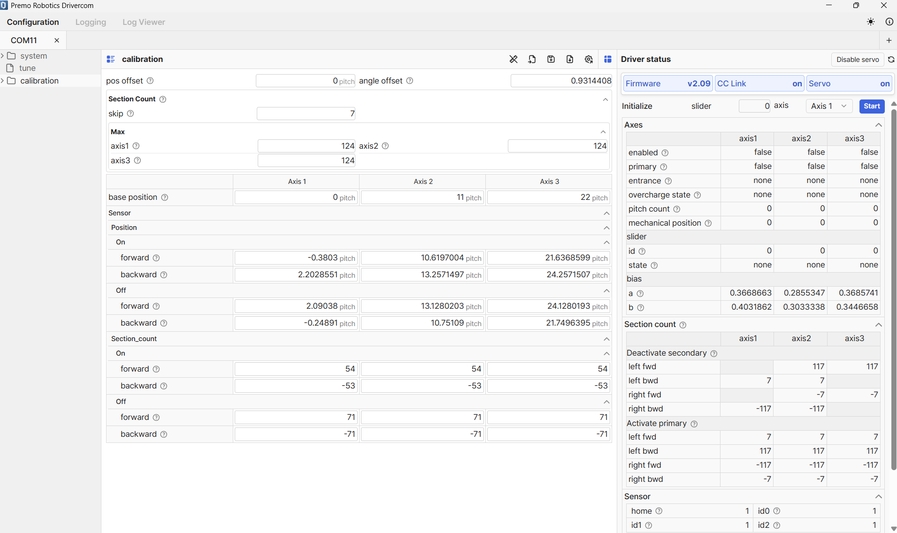

#### Saving settings to the controller

> [!IMPORTANT]
> **Both the servo and CC-Link must be OFF** before saving. CC-Link stays enabled while the server on the PC is running, so shut down the server first.

1. Shut down the server running on the PC.
2. Click the refresh button in `Driver status` and check that CC-Link is OFF.
3. Click `Disable servo` at the top right of `Driver status` and select the target driver.
4. Check that the servo has turned OFF.
5. Click the save button.
6. Saving is complete when the `Communication Success` message appears at the top right.

| Disable servo | Save complete |
|---|---|
|  | 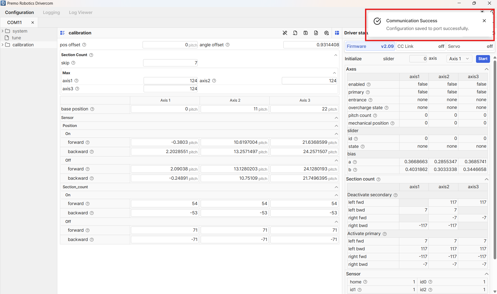 |

### 2. Data Logging

#### Basic logging

1. Select the items to record in `Log Config`.
2. Set `duration` (seconds) and `Axes` (axis1–axis3).
3. Click `Start logging` and select the driver to log from.
4. Specify the CSV save location. Progress is shown in the download manager at the bottom right.
5. When finished, click the file button in the download manager to open the log directly in the Log Viewer.

The Log Config (items, duration, axes and command) can be imported from or saved to a file with the import and floppy disk buttons, and recently used files are listed for quick access.

#### Logging while a slider is moving

1. Enter values in the `Initialize` bar on the right and select the driver on which to register the slider.
2. On success, the axis information appears under `slider`.
3. Select `speed_profile` or `position_profile` in `Command type`. The default, `current_state`, logs without moving the slider.
4. Enter the travel distance, speed, acceleration and slider ID, then click `Start logging`.


### 3. Log Viewer

| Function | How to use |
|---|---|
| Open file | Open file button → select a CSV file |
| Show/hide legend | Click a legend item |
| Tooltip | Hover over the graph |
| Horizontal zoom | Select horizontal zoom and drag (`Shift`); mouse wheel zoom supported |
| Vertical zoom | Select vertical zoom and drag (`Ctrl`); mouse wheel zoom supported |
| Cursor lock | Select cursor lock and click a position (`Alt`) |
| Pan | Select pan and drag |
| Reset | `Reset` button → restores the original zoom and graph layout |
| Partial save | Saves only the visible legends within the horizontal zoom range as CSV |
| Legend search | Hide all → search → show legends button (clear the search to show all) |
| Range select | `Shift` + click a second legend checkbox or visibility toggle to apply it to every legend in between |
| Split graph | Split button → check legends → split |
| Reorder graphs | `Reorder Graph` button → drag and drop the move handle |
| Merge graphs | Check the graphs to merge → merge button |
| Legend style | Button left of the legend → set color and line style (dotted/dashed/solid) → save |

| Horizontal zoom | Split graph | Legend style |
|---|---|---|
| 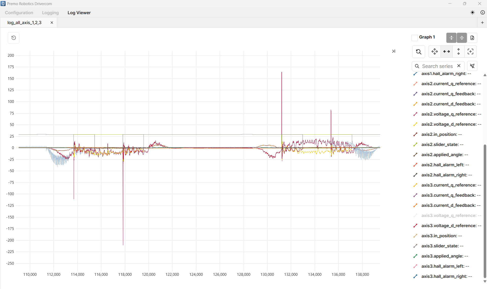 |  | 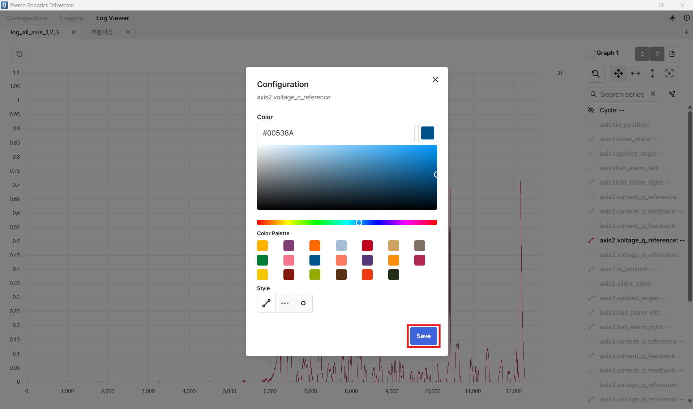 |

### 4. Vibration Logger

Records vibration from a MicroStrain G-Link-200 wireless accelerometer (the node) through a MicroStrain WSDA-200-USB (the base station), plots it live and saves it as CSV. The page drives both devices with the bundled `vilo` tool.

#### Before you start

1. Connect the base station to the PC by USB.
2. Open the `Vibration Logger` page. It looks for base stations when it opens. If it finds none, it shows `No base station found`: connect the base station and click `Refresh`.
3. Turn on the node. To connect by search, turn it on only after the search has started (see [Connecting by search](#connecting-by-search)).

When several base stations are connected, the page uses the first one. Choose another in the `Port` list of the Base station card.

#### Connecting by node address

The node must already be on the base station's frequency and protocol. Its address is printed on the label of the node.

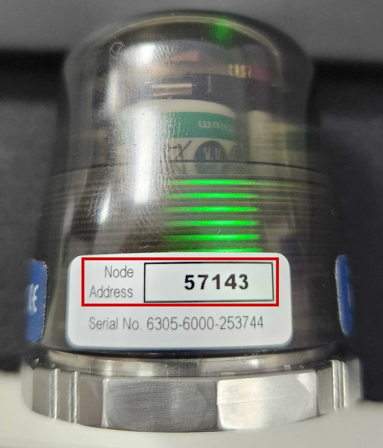

1. Type the node address in the field marked 1 in the image below.
2. Click `Connect` or press `Enter`.

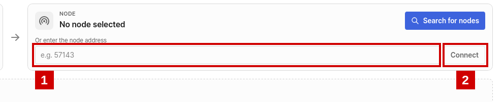

When the node answers, the Node card shows its address, frequency, protocol and transmit power, and the Logger appears below.

#### Connecting by search

The search finds a node on any frequency, but only while the node powers up.

> [!IMPORTANT]
> Start the search **before** turning the node on. A node that is already on is not found: turn it off, start the search, then turn it on.

1. Click `Search for nodes`. The search listens for 60 seconds.
2. Turn the node on. It announces itself while it powers up.
3. The node appears in the list as `address · model`, with its frequency, its protocol and whether the base station has to switch.
4. Click `Use`. If the node's frequency or protocol differs from the base station's, the base station switches to the node's first.

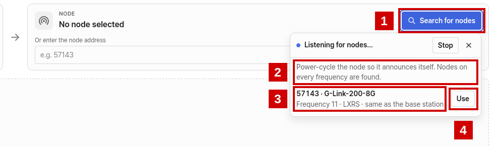

`Stop` ends the search early. Once the search has ended, after 60 seconds or after `Stop`, `Stop` becomes `Search again`, which clears the list and listens for another 60 seconds.

#### When the node does not answer

The Node card shows `Unreachable` when the node does not answer the page's ping, after connecting by node address or when `Start logging` fails. The node may be asleep, switched off, out of range or on another frequency than the base station.

1. `Unreachable` marks the node, and the card lists why it may not answer.
2. `Set to idle` wakes a sleeping node, which takes up to about 10 s. The page then pings the node again: when it answers, the node is selected and the Logger appears. A node that is not asleep (switched off, out of range or on another frequency) does not answer, and the page shows the error `Node … was not set to idle`.
3. `Change node` releases the node so that another can be chosen.

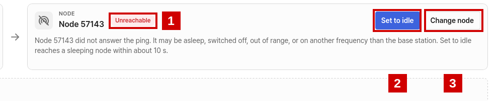

A node chosen with `Use` that does not answer is not kept: the Node card returns to `No node selected` and shows `Node … did not answer`. Check that the node is on and in range, then search again.

#### Log settings

The Logger appears once a node is connected. The four log settings show the node's current values and are written to the node when the session starts.

1. `Sample rate`: samples per second on each channel, 512, 256, 128 or 64 Hz.
2. `Input range`: the measuring range, ±2, ±4, ±8, ±10, ±20 or ±40 g.
3. `Low-pass filter`: the cut-off of the node's low-pass filter, which attenuates vibration above it, 209, 104, 52 or 26 Hz.
4. `High-pass filter`: `Auto` removes the constant part of the signal, such as gravity, so each channel centers on 0 g. `Off` keeps it.
5. `Store limit`: how much of the newest data the page keeps, 1 min to 1 h (default 10 min). Older data is dropped, so `Save CSV…` saves at most this much.
6. `Start logging` starts the session.

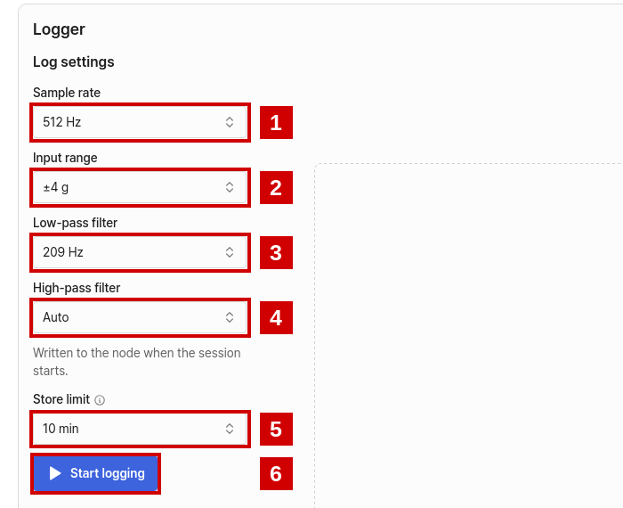

The node rejects a value its model does not support, and the session does not start.

#### During a session

1. `Elapsed` shows the time since the session started, which keeps running while paused, and the number of samples kept.
2. `Pause` sets the node to idle: sampling stops, and the session and its data stay. The button becomes `Resume`, which restarts sampling in the same session.
3. `Save CSV…` saves the data kept so far, including the samples just received, and can be used at any time during or after the session. The default name is `vibration_YYYY-MM-DD_HHMM.csv` (the session start time). The columns are `tick`, `timestamp` (ns since the Unix epoch), `ch1`, `ch2` and `ch3`.
4. One tile per channel, `ch1 (X)`, `ch2 (Y)` and `ch3 (Z)`, shows the RMS, min, max, p-p (peak to peak) and avg of the range shown on the plot. Click a tile to hide or show its channel.
5. The range strip selects what the plot shows. By default it shows the newest 30 s and follows live data. Drag the handles to choose a range; while the right handle is at the newest sample, the plot keeps following live data. `Show all` shows all the data kept.
6. `End session` stops the node and ends the session. The data stays on the plot and can still be saved, and `Load CSV…` appears to open a saved file.

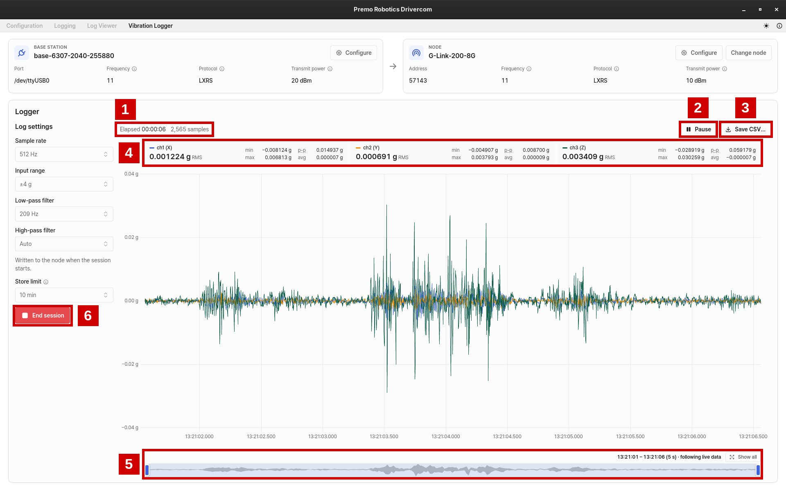

> [!WARNING]
> `Start logging` clears the plot, and leaving the page or closing the app ends the session. **Save the data first**, or it is lost.

> [!NOTE]
> During a session, `Configure`, `Log settings`, `Store limit`, the base station `Port` and `Change node` are locked.

If `Start logging` fails, the page checks the devices again. A base station that no longer responds is removed and the page returns to `No base station found`; a node that does not answer is marked `Unreachable`.

#### Fixed device settings

The page writes the following settings itself. They cannot be changed from the GUI.

> [!NOTE]
> These values were chosen so that users have fewer settings to understand on this page. They are set in `vilo` ([premorobotics/ViLo](https://github.com/premorobotics/ViLo)), so a different value is possible by changing `vilo`:
>
> | Settings | Set in |
> |---|---|
> | Node, written at every `Start logging` | `src/log/config/set.zig`; the active channels in `src/log/start.zig` |
> | Node, written when its radio settings are applied | `src/node/config/set.zig` |
>
> The GUI uses the change once it is in a `vilo` release, which `pnpm tauri` downloads, or from a custom `vilo` binary in `src-tauri/binaries` (see `unpack.js`). Which radio settings can be edited (the last table) is decided by the page itself, in `src/pages/VibrationLogger.tsx` and the cards in `src/features/VibrationLogger/`.

Node, written at every `Start logging`:

| Setting | Value |
|---|---|
| Sampling mode | Non-synchronized |
| Sampling duration | Unlimited, until `Pause` or `End session` |
| Data collection | Transmit only; nothing is stored on the node |
| Data format | Calibrated float |
| Sensor output | Acceleration |
| Data mode | Raw |
| Diagnostic interval | 0 (no diagnostic packets) |
| Active channels | `ch1`, `ch2`, `ch3` |

Node, written whenever its radio settings are applied (node `Configure` → `Apply`, or a protocol change on the base station):

| Setting | Value | Purpose |
|---|---|---|
| Default mode | Idle | Required to start logging |
| Inactivity timeout | 1200 s | Saves battery: idle time before the node sleeps |
| Check radio interval | 10 s | Saves battery: how often a sleeping node listens |

Radio settings:

| Setting | Base station | Node |
|---|---|---|
| Frequency | Follows the node chosen with `Use` (11–26); no manual setting | Not changeable |
| Protocol | `Configure`: LXRS or LXRS+, also set on the connected node | Follows the base station |
| Transmit power | `Configure`: 20, 16, 11, 10, 5 or 0 dBm | `Configure`: 20, 16, 12, 11, 10, 5, 1 or 0 dBm |

A device rejects a transmit power that its region does not allow.

The log settings offer only the values for non-synchronized sampling on the G-Link-200 (see [Log settings](#log-settings)).

### 5. Tabs, Panels and Files

| Function | How to use |
|---|---|
| New tab | `+` button at the end of the tab bar |
| Rename tab | Double-click the tab name, type, then press `Enter` |
| Split panel | Drag a tab to the edge of a panel; the highlighted area shows where the new panel will be placed (`Esc` cancels the drag) |
| Open by drag and drop | Drop one file onto a panel (`.json5` on Configuration/Logging, `.csv` on Log Viewer). Dropping in the middle opens it as a new tab; dropping on the left/right quarter splits the panel |
| Changed settings | On Configuration tabs, a colored mark shows that the settings differ from the opened file |

## Shortcuts

`Shift`, `Ctrl` and `Alt` switch the Log Viewer cursor mode only while held; releasing the key returns to the previously selected mode.

| Input | Function | Notes |
|---|---|---|
| `Shift` + drag | Horizontal zoom | |
| `Ctrl` + drag | Vertical zoom | |
| `Alt` + click | Cursor lock | |
| Mouse wheel | Zoom horizontally and vertically around the cursor | |
| `Shift` + wheel | Zoom using horizontal scroll | For touchpads / horizontal wheels |
| Double-click (horizontal zoom mode) | Reset horizontal and vertical zoom | Horizontal zoom resets only in horizontal mode |
| Double-click (vertical zoom mode) | Reset vertical zoom | Horizontal zoom is kept |
| `Shift` + click (legend checkbox / visibility) | Apply to the whole range from the previous click | |
| `Shift` + click (settings checkbox) | Apply to every checkbox between the previous click and this one | Within the same group |
| Double-click (tab name) | Rename tab | |
| `Esc` (while dragging a tab) | Cancel tab drag | |

## Parameter Reference

Types: `u8`/`u16`/`u32` unsigned integer, `i16` signed integer, `f32` float, `bool` true/false. The unit `pitch` is a position unit where one slider magnet pitch equals 1.

<details>
<summary><b>System · Flags · Line</b></summary>

| Field | Type | Unit | Description |
|---|---|---|---|
| `id` | u16 | | Driver ID, unique per Line. The first driver is 1, then consecutively increasing |
| `station` | u16 | | CC-Link station ID (unique per Track) |
| `cc_link_speed` | CcLinkSpeed | | CC-Link communication speed |
| `retry_count` | u8 | | Retries for synchronous communication between drivers |
| `voltage_warmup` | f32 | V | Maximum voltage applied to find the sensor angle offset |
| `hall_cutoff_freq` | f32 | Hz | Cut-off frequency of the sensor smoothing filter |
| `overcurrent_timeout` | f32 | s | Minimum overcurrent duration before alarm |
| `pos_offset` | f32 | pitch | Position offset |
| `right_sensor_distance` | f32 | | Distance from the right sensor to the right end of the axis (XTS only) |
| `angle_offset` | f32 | | Normalized sensor angle offset (measured by calibration) |
| `flags.home_exists` | bool | | Driver has a home sensor |
| `flags.has_neighbor.backward` / `forward` | bool | | Another driver is connected on the left / right |
| `flags.use_axis.axis2` / `axis3` | bool | | Uses the second / third axis (axis2 must be true to use axis3) |
| `flags.calibration_spare.backward` / `forward` | bool | | Spare space left of the first axis / right of the last axis during calibration |
| `flags.collision_avoidance` | bool | | Collision Avoidance System enabled |
| `flags.calibration_use` | bool | | Calibration information used for LMDS actions |
| `flags.xts` | bool | | true: XTS, false: LMS |
| `flags.flip` | bool | | Exchange cosine and sine sensor readings |
| `flags.swap` | bool | | Switch the order of the two sensors in the axis |
| `line.axes` | u32 | | Total number of axes in the Line |
| `line.axis_length` | f32 | m | Distance between axis coil centers |
| `line.slider.mass` | f32 | kg | Slider mass including load |
| `line.slider.length` | f32 | m | Slider length |
| `line.magnet_pitch` | f32 | m | Distance between two N poles of the slider magnet |
| `section_count.skip` | i16 | | Section count at which the next axis becomes primary |
| `section_count.max.axis1~3` | i16 | | Maximum section count while each axis is primary |

</details>

<details>
<summary><b>Per-axis motor constants · gains · calibration (<code>axes[n]</code>)</b></summary>

| Field | Type | Unit | Description |
|---|---|---|---|
| `rs` | f32 | Ω | Stator resistance (line to neutral) |
| `ls` | f32 | H | Stator inductance (line to neutral) |
| `kf` | f32 | N/A | Force constant (newton per ampere) |
| `kbm` | f32 | V/(m/s) | Back EMF constant |
| `max_current` | f32 | A | Maximum peak coil current |
| `continuous_current` | f32 | A | Maximum continuous coil current |
| `gain.current.p` / `i` | f32 | | Current control P / I gain |
| `gain.current.denominator` | u16 | | Divider of the 15 kHz sampling frequency for current control bandwidth |
| `gain.speed.p` / `i` | f32 | | Speed control P / I gain |
| `gain.speed.denominator` | u16 | | Divider of current control bandwidth for speed control bandwidth |
| `gain.speed.denominator_pi` | u16 | | Divider of speed control bandwidth for PI corner frequency |
| `gain.position.p` | f32 | | Position control P gain |
| `gain.position.denominator` | u16 | | Divider of speed control bandwidth for position control bandwidth |
| `arrival_threshold` | f32 | m | Position error tolerance for movement completion |
| `base_position` | f32 | pitch | Base position of the axis |
| `sensor.position.on.forward` / `backward` | f32 | pitch | Right sensor ON position (forward) / left sensor ON position (backward) |
| `sensor.position.off.forward` / `backward` | f32 | pitch | Left sensor OFF position (forward) / right sensor OFF position (backward) |
| `sensor.section_count.on/off.forward/backward` | i16 | | Section counts at the sensor ON/OFF points above |

`base_position` and all `sensor.*` values are measured by calibration.

</details>

<details>
<summary><b>Driver status (<code>state</code>)</b></summary>

| Field | Type | Unit | Description |
|---|---|---|---|
| `state.servo_enabled` | bool | | Servo is on |
| `state.cc_link_enabled` | bool | | CC-Link is on |
| `state.calibrated` | bool | | Calibration completed |
| `state.vdc` | f32 | V | Motor coil supply voltage |
| `state.thermo` | f32 | | Inverter temperature |
| `state.sys_version` | f32 | | Firmware version |
| `state.sensor.home` / `id0~id2` | u8 | | Sensor readings (0 if sensed) |
| `state.synchronization_request_position.forward` / `backward` | f32 | | Position to receive a profile request from the next axis during backward / forward calibration |
| `state.section_count.deactivate_secondary.*` | i16 | | Section counts at which the secondary axis is deactivated |
| `state.section_count.activate_primary.*` | i16 | | Section counts at which a deactivated axis becomes primary again |
| `state.axes[n].enabled` / `primary` | bool | | Axis is active / primary |
| `state.axes[n].slider.id` / `slider.state` | u8 / Fsm | | ID / state of the slider on the axis |
| `state.axes[n].entrance` | Entrance | | Side from which the slider entered |
| `state.axes[n].overcharge_state` | Fsm | | Slider state before overcurrent |
| `state.axes[n].pitch_count` | i16 | | Pitch count |
| `state.axes[n].mechanical_position` | f32 | pitch | Slider position (integer part = number of magnet pitches) |
| `state.axes[n].bias.a` / `b` | f32 | A | A-phase / B-phase current offset |

Section count thresholds refer to the primary axis. Forward triggers when count ≥ value; backward triggers when count ≤ value.

</details>

<details>
<summary><b>Log items (<code>Log Config</code>)</b></summary>

| Item | Description |
|---|---|
| `profile_position` / `profile_speed` | Profile output position / applied speed |
| `position_output` / `position_reference` / `position_feedback` | Position controller output / reference / feedback |
| `speed_reference` / `speed_feedback` | Speed controller reference / feedback |
| `current_q_reference` / `current_q_feedback` / `current_d_feedback` | Q-axis current reference / Q- and D-axis current feedback |
| `voltage_q_reference` / `voltage_d_reference` | Q- / D-axis voltage reference |
| `voltage_q_feedforward` / `voltage_d_feedforward` | Q- / D-axis voltage feedforward |
| `calculation_time` | Control loop calculation time |
| `theta_section` | Theta section |
| `electrical_angular_speed` | Electrical angular speed |
| `in_position` | In-position state of profile movement |
| `current_a` / `b` / `c` | A/B/C-phase current |
| `voltage_alpha` / `voltage_beta` | Alpha/beta-axis voltage |
| `voltage_a` / `b` / `c` | A/B/C-phase voltage |
| `slider_state` | Slider FSM state |
| `applied_angle` / `encoder_angle` | Applied angle / angle measured by the encoder |
| `vector_sector` | Vector sector number |
| `hall_alarm_left` / `hall_alarm_right` | Left / right hall sensor alarm |

</details>

## Glossary

| Term | Description |
|---|---|
| Driver | Controller that drives the motor coils, identified by ID within a Line |
| Line | Transport line made up of one or more drivers (LMS or XTS) |
| Axis | Drive section controlled by a driver; up to three axes per driver |
| Slider | Moving element (carrier) that travels along the line |
| Section count | Count used for slider handover between axes and primary/secondary switching |
| pitch | Position unit where the distance between slider magnet N poles equals 1 |

## Documentation

See the user manual for detailed procedures and all screenshots.

- [User Manual (English)](docs/manual/Drivercom_GUI_User_Manual_Rev1.0_EN.docx)
- [User Manual (Korean)](docs/manual/Drivercom_GUI_User_Manual_Rev1.0_KR.docx)

## Development

### Requirements

1. `pnpm`
2. `rustc` & `cargo`
3. [`gh`](https://cli.github.com/) (GitHub CLI), logged in with access to `pmotionf/drivercom-cli`

> [!NOTE]
> `pnpm tauri ...` first runs `pnpm run drivercom`, which downloads the `drivercom-cli` binary from the GitHub releases of `pmotionf/drivercom-cli` with `gh release download` and generates the config types into `src-tauri/generated/config`. Run `gh auth login` beforehand.

### Setup

```sh
pnpm i
pnpm fmt
pnpm check
pnpm test
```

### Running

To run a development build, use `pnpm tauri dev`.

To build the installer, use `pnpm tauri build`.

---

© PREMO Robotics Co., Ltd. · Author: Hyuna Kim · 2026-11-19
